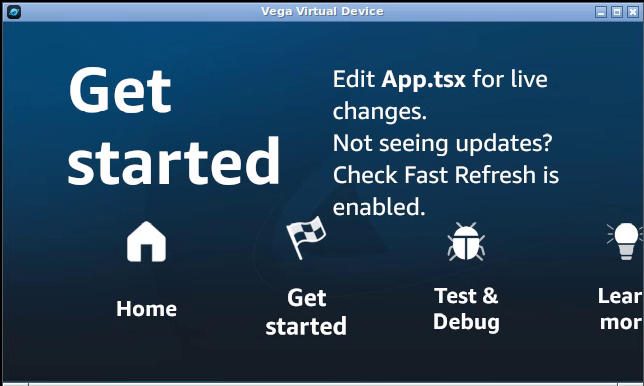

# Vega TV Lab

A small, reproducible runtime check for Amazon's official Vega Virtual Device on an Ubuntu GitHub Actions runner.

The manual workflow installs the official SDK, builds its Hello World template, starts the virtual TV, sends remote-control keyboard input, and records the resulting screen. Logs and recordings are uploaded as a short-lived Actions artifact.

**Verified October 14, 2026:** the official Hello Vega app builds and runs, Right opens “Get started,” and Back returns to the virtual TV launcher. [Successful run](https://github.com/blucca/vega-tv-lab/actions/runs/38449037674) · [20-second screen recording](evidence/remote-input.mp4).

Recorded with SDK `0.24.12112`, Vega CLI `1.4.4`, React Native `0.83`, Ubuntu `24.04`, KVM, Xvfb, and Openbox. The complete clean-run job took 5m 13s.

## Run

Open **Actions → Official Vega runtime → Run workflow**. The job uses an Ubuntu runner with KVM and a software-rendered X display. SDK `0.24.12112` installation and generated sample files stay in `temp/`; artifacts contain logs and screen recordings.

Choose a published SDK version with `vega sdk list-remote`. The CI documentation example `0.24.9311` returned “Version not found” on October 14, 2026; the registry listed `0.24.12112` as the latest release.

## First-boot details

- A clean hosted runner opens the emulator's nested-virtualization information dialog. Openbox gives it keyboard focus; Enter continues startup.
- The CLI's initial “ready” message arrives before the guest's application services finish starting. The probe waits for VDA and a successful `running-apps` call before installation.
- The recorded display uses 1280×720. The stock sample has text wrapping at that size; the recording preserves its actual output.
- `device install-app` takes `-p`; `device launch-app` takes `--appName`. `run-app` provides the combined operation.

## References

- [Official SDK installation](https://developer.amazon.com/docs/vega/0.24/install-vega-sdk.html)
- [Official CI installation](https://developer.amazon.com/docs/vega/0.24/continuous-integration.html)
- [Official sample build](https://developer.amazon.com/docs/vega/0.24/build-an-app)
- [Virtual-device and remote-control reference](https://developer.amazon.com/docs/vega/0.24/run-apps.html)

The workflow and probe script use the MIT license. Amazon SDK, generated template materials, and the Hello Vega sample shown in the recording retain their upstream [Program Materials license](https://developer.amazon.com/support/legal/pml). SDK binaries are fetched from the official installer during each run.
